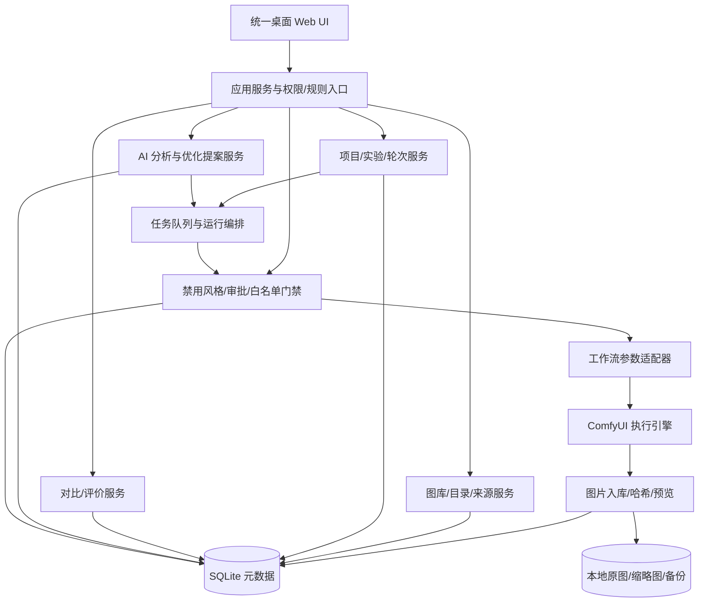

# 图片风格智能迭代工作台：执行架构与落实方案 V3.2

> 文档性质：面向开发 AI / 工程人员的实施基线（可拆分为任务单）。
> 核心目标：让用户在“目标参考 → 批量生成 → 本地图片对比 → 人机评价与讨论 → 修改风格/生成参数 → 再次生成”闭环中逐步逼近目标视觉风格。
> 实施原则：**保留可用生成能力；重构交互与数据关系；先建立可追溯实验，再加入 AI 主动优化。**
> 基线说明：本文件依据当前产品目标、此前已确认规则及现有 EXE 所代表的软件形态编制。由于未取得源码和完整 Windows 运行测试结果，不能把某个功能“存在/缺失”的推测当作已验收事实。P0 必须实际核对代码、数据与运行行为。

## 0. 总体执行结论

### 0.1 新定位

将软件定位为**目标驱动的图像风格实验与智能迭代工作台**，不是单纯的 ComfyUI 批处理器、图库或提示词管理器。最小闭环为：一个项目目标、一次实验、一组候选图、一组可追溯评价、一份经确认的优化方案、下一轮生成。

### 0.2 成功标准

1. 同一个项目中完成多轮实验，保留每轮图像、输入、提示词、模型/LoRA、工作流、种子、参数、评价、决策和来源关系。
2. 人工与 AI 都能提出评价，但用户偏好与锁定规则拥有更高优先级，AI 不得擅自覆盖。
3. 能够进行 A/B 对比、候选墙、局部对比、跨轮次对比；能够与本地文件夹图片比较。
4. 每次优化应能解释“改了什么、为什么改、哪些未改、效果如何”，且能完整回退。
5. 界面突出图像主体，减少表单、重复入口与跳页，不牺牲批量操作效率。
6. 淘汰风格不得在未获批准时被生成链路重新使用；任何白名单加入都需要用户明确同意。

### 0.3 非目标（第一阶段不要做）

- 不直接训练或微调基础图像模型，不承诺“自动学习”等于模型权重更新。
- 不直接把 AI 评分作为唯一真值；不凭相似度分数自动覆盖审美选择。
- 不先推倒重写 ComfyUI 执行层；不为了新框架牺牲旧任务与旧图库。
- 不将图库扩展为庞杂的多条件筛选器；图库筛选只保留**生产文件夹**与**文件夹创建日期**。

---

## 1. 产品与信息架构

### 1.1 六个顶层模块

| 模块 | 核心职责 | 用户直接看到的结果 | 边界 |
|---|---|---|---|
| 项目中心 Projects | 聚合视觉目标、文件夹、参考图、规则、实验、成员权限（本地可先单用户） | 项目主页、目标面板、进度及历史 | 不实际执行生图 |
| 实验生成 Lab | 管理工作流、参数、锁定变量、批量任务和每轮生成 | 实验编辑器、批次运行状态、输出图 | 必须经过治理门禁 |
| 图库 Assets | 分层文件夹、图片详情、来源绑定、本地图片引用、缩略图 | 图库、目录树、详情页 | 不在这里实现迭代决策 |
| 视觉对比 Compare | A/B、候选墙、局部、跨轮次、人工评价 | 对比画布、选择结果、差异摘要 | 评价必须绑定证据 |
| AI 迭代 Optimize | 视觉分析、假设、优化提案、生成下一轮计划 | 建议解释、修改差异、审批操作 | 不直接绕过门禁或用户锁定 |
| 历史与治理 History & Rules | 实验谱系、淘汰记录、白名单、审批、恢复及审计 | 时间线、版本差异、禁用与例外 | 唯一权限判定入口 |

### 1.2 主导航（固定 5 个常用入口 + 设置）

`项目 / 实验 / 对比 / 图库 / 历史`；“AI 助手”优先设计为右侧上下文面板，而非割裂的独立聊天室；“设置”集中管理 ComfyUI、模型、插件、路径、主题和高级选项。所有页面显示当前项目/实验上下文。

### 1.3 典型用户路径

1. 新建/打开项目 → 选择目标参考图（本地图/已有生成图）→ 定义硬约束与想优化的维度。
2. 选工作流、模型、LoRA、风格档案及批次数 → 锁定需要保持不变的变量。
3. 点击“生成本轮” → 服务端验证规则 → 执行 ComfyUI → 结果自动归入项目/轮次/生产文件夹。
4. 在候选墙浏览，或与目标图/本地图 A/B 比较 → 选优/标记问题/局部反馈。
5. AI 汇总本轮差距 → 提交结构化优化提案，附明确参数 diff 和依据。
6. 用户批准部分/全部建议，或切换到预授权的有边界自动模式 → 创建新轮次。
7. 通过跨轮次视图比较改进是否有效 → 保留最佳分支，必要时回滚。

---

## 2. 核心业务对象与不可变关系

### 2.1 数据模型

| 对象 | 必备字段（至少） | 设计要求 |
|---|---|---|
| Project | id, name, description, reference_asset_ids, constraints, folder_root, created_at | 一个目标可关联多个实验 |
| StyleProfile | id, name, version, dimensions, preferred_settings, tags, origin, parent_version | 评分偏好与生成参数分离；版本不可覆盖 |
| Experiment | id, project_id, goal, baseline_run_id, locked_fields, tunable_fields, status | 显式定义哪些变量可改 |
| Round | id, experiment_id, index, parent_round_id, goal, proposal_id, status | 形成分支树而非只保存线性历史 |
| GenerationRun | id, round_id, workflow_hash, exact_workflow_snapshot, prompt_snapshot, model_hashes, seeds, size, status, timestamps | 提交给引擎的配置必须完整、不可变 |
| ImageAsset | id, sha256, uri/path, width, height, created_at, origin_folder_id, source_id, run_id, preview_path | 图片身份不依赖可变路径 |
| Folder | id, parent_id, absolute_path, creation_time, folder_type | 原始层级可复现，记录日期来源 |
| Comparison | id, experiment_id, mode, target_asset_id, candidate_ids, scope_folder_id | 支持目标图、本地图和旧轮次 |
| Evaluation | id, asset_id(s), reviewer_type, preference_choice, aspect_scores, selected_regions, reasons, timestamp | 保存评价证据，区分 human/AI |
| OptimizationProposal | id, round_id, evidence_refs, hypothesis, parameter_diff, expected_effect, risk, status | 可部分批准、拒绝、编辑和回退 |
| PolicyRecord | id, style_key, evidence_asset_ids, decision, scope, approval, whitelist_exception, audit | 所有生成入口统一强制检查 |
| EventLog | id, actor, action, target, before/after, timestamp | 重要操作可审计、可恢复 |

### 2.2 存储策略

- 使用 SQLite（建议 WAL 模式）存储结构化数据；采用明确版本迁移机制（如 Alembic 或等效工具）。
- 原图优先按既有本地文件保存，不强制搬运；导入时可采用“引用”或“复制入库”，来源方式需明示。缓存缩略图独立保存，可再生。
- `ImageAsset` 用内容哈希识别重复内容，用稳定 ID 关联评价、来源与谱系；路径变动时允许重新定位，不把同一张图误当成新作品。
- 工作流 JSON、实际提示词、模型及 LoRA 标识/哈希、种子、采样参数、执行版本等形成**不可变运行快照**；任何编辑生成新版本。
- 数据与图片分开备份，提供一键备份/恢复；不可在迁移时静默覆盖用户原图。
- 大图库扫描、哈希和预览构建放入后台队列，提供进度、错误与取消；扫描支持增量、去重和重试。

### 2.3 文件夹规则（已确定，必须照办）

- 图库仅保留两项筛选条件：**生产文件夹**、**文件夹创建日期**；排序、搜索与快捷定位等界面便利功能不能偷偷引入其他筛选条件。
- 文件夹显示为真实可展开的嵌套目录：先进入大文件夹，再浏览其下级生产文件夹和图片；支持面包屑与返回原位置。
- Windows 创建时间需优先读取可靠的文件系统创建时间；无法取得时明确显示“未知”，不能把修改时间悄悄当成创建时间。
- 图片详情采用半透明面板，展示来源路径、所属生产文件夹、参数、评价及跳转入口。
- “同类图片”由用户明确选择比较范围：**当前文件夹**或**所属大文件夹**；列出路径供确认，点击同类缩略图直接进入目标图片详情并保留返回位置。
- 支持给文件夹和图片记录来源（链接、手动描述、外部路径或已有项目），但不把“来源”新增成图库筛选维度。

---

## 3. 风格与生成参数的三层模型

### 3.1 硬约束层（Hard Constraints）

如角色身份、指定画幅、服装结构、不得使用的风格、已经确认的淘汰特征、必须保留的内容。违反约束的提案与生成任务应先阻断，不能通过较高总评分抵消。

### 3.2 审美偏好层（Preference Dimensions）

默认维度：笔触/线稿、综合色彩、光影、材质、面部与手部精度、构图空间、装饰密度、风格一致性。每维包含重要性（0–100）、期望方向、局部区域和证据。允许为项目定制，不强制所有项目使用相同维度。

### 3.3 实际生成层（Execution Parameters）

真实的工作流节点输入、提示词片段、模型/LoRA 与数值、采样器、步数、CFG、种子、参考图/IPAdapter/ControlNet 等（以实际工作流支持为准）。只能通过经过验证的**工作流参数适配器**写入，不能把偏好分数直接当作 LoRA/CFG 等参数。

### 3.4 风格档案版本化

保存 `StyleProfile v1/v2/v3`，每个版本具有父版本、修改人/AI、变更理由、适配工作流和引用实验。支持“复制并探索分支”“恢复此版本”“设为本项目默认”，不静默覆盖历史风格。

---

## 4. 图像对比与评价系统

### 4.1 四种比较模式

1. **A/B 盲测**：两张等比例展示，同步缩放/平移，快捷键选择左、右、相当、都不满意；避免用户被生成顺序影响。
2. **批量候选墙**：支持缩略图大小、等比完整预览、多选、标记、相似聚合与延迟加载；主要用于大量作品粗筛。
3. **局部对比**：标注脸、眼睛、手、裙摆、光照区等任意框选区域，绑定“喜欢/不满意/如何修改”的具体反馈；同步对齐时不破坏原图。
4. **跨轮次对比**：选择不同轮次最佳图片，显示差异参数、质量变化、人工判断和来源链；支持对比分支，不只线性前后两版。

### 4.2 一次评价最少需要的数据

`候选图片 + 与谁比较 + 选哪张 + 可选的原因标签 + 可选的文字/局部区域 + 评价者 + 时间`。避免强迫填写复杂表单。保留评价原记录，允许追加更正记录而不篡改历史。

### 4.3 人工与 AI 决策优先级

1. 用户显式禁止/锁定 > 用户明确审批与评价 > 项目规则 > AI 建议 > 自动探索。
2. AI 评分与人工评分分列展示，不能混成一个不可解释的总分。
3. AI 评价输出：依据、具体区域或可观察特征、置信度、不确定性、可能的替代解释。
4. 若 AI 与用户矛盾，要求确认或引用已有用户决策；不得自动纠正用户“审美错误”。

---

## 5. AI 迭代引擎设计

### 5.1 一轮优化的输入与输出

**输入：**目标图、参考图、固定变量、可调变量、旧轮次运行快照、候选图、人工对比偏好、局部反馈、禁用风格清单、预设预算。

**输出：**结构化 `OptimizationProposal`，至少包含：待解决问题、证据图/评价、修改假设、精确变更参数（old/new）、预计影响、风险、应保持不变的项目、建议生成数量、验证办法。

### 5.2 决策算法（先可解释，后智能化）

- 将用户维度重要性归一化为 `w_i`，对各候选的该维质量分 `s_i(x)` 计算辅助分：`Q(x) = Σ w_i * s_i(x)`；总分**仅辅助排序**，不可越过硬约束和用户明确的 A/B 选择。
- 人工成对偏好单独建模；初期可用胜率/Bradley–Terry 或简单偏好排序，不要求训练大型模型。
- 第一版每次优先只调整 1–3 个可控变量，保留对照组和已确认有效配置；记录相同种子/相同主体条件以减小噪声（但不同模型未必可严格可比）。
- AI 生成具体优化假设，而不是笼统输出“增强高级感”“降低权重”。例如应表达为“把指定 Bloom 节点强度从 A 改为 B，其他照明节点锁定”，且先验证该节点存在。
- 留出少量探索候选（可配置），防止优化陷入局部最优；探索不得突破硬约束/预算。
- 自动对比新旧轮次时使用用户选优比例、盲测结果、约束违规率和明确局部问题是否改善，不承诺单个 AI 评分持续上升等于真正进步。

### 5.3 三种运行模式

| 模式 | AI 做什么 | 何时运行 |
|---|---|---|
| 手动 | 分析、评分、建议，用户逐项配置和启动 | 默认可以随时使用 |
| 协作 | AI 生成完整下一轮提案，用户批准后提交 | 建议默认主模式 |
| 有边界自动 | 在用户明确授权的模型/节点/权重范围、最大轮次/张数/成本内循环 | P5 稳定后开放；可随时暂停 |

### 5.4 状态机与安全

`实验 Draft → Ready → Generating → Review → ProposalPending → Approved/Rejected → NextRound`。

每条生成运行任务至少支持 `Queued → Running → Completed/Failed/Cancelled`，如执行引擎支持可增加 `Paused` 和恢复。所有状态写入事件日志，确保异常退出后可以恢复状态；重试需使用幂等键，避免重复生成、重复计费或重复落库。

**最重要的规则：**凡标记淘汰的风格证据再次匹配到待用风格时，必须反馈给用户并阻止使用，直到用户批准具体复用请求。白名单只能经用户明确同意添加；AI 无权自批或通过修改名称绕过。规则必须在服务端真实执行入口统一检查，覆盖批量、重做、恢复和自动迭代。

---

## 6. UI/UX 设计与组件规范

### 6.1 设计语言

以图像为视觉中心，默认专业深色主题，提供浅色主题。建议主背景 `#12151B`、面板 `#1E232D`、分隔 `#303847`、正文 `#E8EBF2`、重点交互 `#8B9FFF`；颜色作为设计令牌而非散落的硬编码。审美方向：中性沉浸、克制层次、适度圆角、稳定排版、弱化无关装饰。

### 6.2 主画面布局

- **左栏**：项目 / 实验 / 对比 / 图库 / 历史，及项目内部文件夹、轮次树；可折叠。
- **中央画布**：生图结果、候选墙或双图对比；默认占最大区域，缩放保持原始长宽比。
- **右栏**：上下文属性与 AI 助手，切换“信息/评价/优化/参数差异”标签；可折叠。
- **顶部**：项目路径、当前实验轮次、连接状态、任务状态、全局搜索/设置。
- **底栏**：只显示当前任务所需操作与批量状态，不重复堆砌按钮。

### 6.3 页面要点

| 页面 | 主目标 | 关键交互 |
|---|---|---|
| 项目主页 | 明确本次想接近什么 | 目标图、规则摘要、活跃实验、最佳成果 |
| 实验工作台 | 减少重复填写，控制变量 | 基准快照、锁定/可调变量、批量生成、队列进度 |
| 对比工作台 | 快速判断差异 | A/B、全屏、局部、成对偏好、AI 分歧提示 |
| 图库 | 快速定位与打开真实文件 | 多层文件夹、创建日期、来源、图片详情、同类范围选择 |
| 迭代历史 | 明白为什么越来越好/变差 | 轮次树、参数差异、最佳图、回滚、实验笔记 |
| 设置 | 低频配置归位 | ComfyUI、模型目录、缓存、主题、备份/恢复 |

### 6.4 交互要求

- 图片详情采用半透明底板，但文字必须保持足够对比度，避免图像透过文字影响阅读。
- 当前图片点击“同类”后可选择当前文件夹或所属大文件夹；跳到另一张图片的详情后，后退应恢复滚动/选中状态。
- 图像缩放、适应窗口、100%、左右/上下布局、同步对齐要有可见快捷键说明。
- 常用操作少于高级配置一级；风险操作（清空、淘汰、批准复用）必须有明确确认与可追溯结果。
- 低频参数折叠；非必要时不出现大面积表单；空状态提供明确下一步动作。
- 所有异步操作有加载、完成、失败、重试、取消状态；禁止长时间无反馈。
- 首版考虑 Windows 常见桌面分辨率与高 DPI；窗口缩小后不让右侧面板压碎中央画布。

---

## 7. 逻辑架构与接口边界



### 7.1 实现方式

- **先适配，后替换**：现有 Python 服务与 ComfyUI 执行逻辑优先复用；为新 UI 提供稳定的 API 层，避免前端直接操作文件系统和 ComfyUI 私有细节。
- **前端组件化**：如既有前端难以演进，可渐进迁到 TypeScript + React/Vue（二选一，P0 按源码现状确定），先抽取设计令牌、布局、图库卡片、对比组件及状态组件。
- **本地优先**：未经用户许可不上传本地图像至外部 AI；远端 AI 分析按项目配置启用，明确提示发送的图片与元数据。
- **可扩展工作流适配器**：通过节点映射与字段校验暴露可调整参数，只修改已识别且可控的节点；未知工作流采用只读/人工配置，不猜测节点语义。

### 7.2 API 草案（具体路由在 P0 与旧接口映射确认）

| 方法 | 路由 | 用途 |
|---|---|---|
| GET/POST | `/api/projects` | 项目列表/新建 |
| GET/POST | `/api/projects/{id}/experiments` | 查询/新建实验 |
| POST | `/api/experiments/{id}/rounds` | 创建新一轮（含 parent 与 proposal） |
| POST | `/api/runs/validate` | 验证工作流、锁定变量、治理规则、预算 |
| POST | `/api/runs` | 提交幂等生成任务 |
| GET | `/api/runs/{id}` | 任务状态与输出 |
| GET | `/api/assets` | 按生产文件夹/创建日期浏览图库 |
| POST | `/api/comparisons` | 创建对比会话 |
| POST | `/api/evaluations` | 记录人工/AI 评价 |
| POST | `/api/proposals` | 生成/保存优化方案 |
| POST | `/api/proposals/{id}/approve` | 授权精确变更集合 |
| POST | `/api/policies/check` | 所有生成入口统一门禁 |
| POST | `/api/policies/{id}/whitelist` | 仅显式人工审批添加白名单 |
| GET | `/api/experiments/{id}/lineage` | 轮次谱系和 diff |

API 必须有请求/响应 Schema、错误码、权限/审批标志、幂等机制和事件订阅；不要只用前端“按钮置灰”冒充安全控制。

---

## 8. 工程实施任务与依赖关系

> 以下按“完成一个可验收成果”划分，不人为承诺工期。各阶段完成验收才进入下一阶段；可在单独分支并行制作组件，但不得跳过数据基线和安全门禁。

### P0：源码审计、运行基线与数据保护（不可跳过）

- `P0-01` 核实原工程技术栈、入口、ComfyUI 接口、任务队列、图库索引、风格规则、打包方式及已有测试。
- `P0-02` 绘制现有页面、服务、数据表及调用依赖图；区分已实现、部分实现、未实现、代码存在但不可用。
- `P0-03` 制作旧数据与图库备份、恢复验证及迁移映射方案；保留原 EXE 作为回退基线。
- `P0-04` 建立最低回归测试：生成、暂停/恢复（若支持）、批量重做、图库扫描、来源绑定、淘汰规则、白名单审批。
- **验收**：能完整解释旧链路，并在测试副本恢复旧数据；无基线不得迁移。

### P1：统一视觉与导航骨架

- `P1-01` 建立主题令牌、字体与间距、按钮、面板、对话框、空状态、提示、进度组件。
- `P1-02` 实现统一左栏、主画布、右侧上下文面板和任务栏，保留旧功能访问入口。
- `P1-03` 整理页面路由、选中对象状态、返回位置、统一错误提示。
- **验收**：各主页面风格一致；缩放/收起不遮挡关键画布；旧功能可用。

### P2：项目/实验模型与图库改造

- `P2-01` 落地 Project、StyleProfile、Experiment、Round、Run 快照及迁移脚本。
- `P2-02` 落地 Asset、Folder、Source、Lineage、缩略图异步生成及去重。
- `P2-03` 实现真实嵌套目录、两个规定筛选、半透明详情与图片同类范围跳转。
- `P2-04` 将旧生成输出关联到项目和轮次；缺失元数据明确标记 `legacy_unknown`，不得补造。
- **验收**：旧图片能浏览且未被改动；新增图片可由轮次找到完整生成快照。

### P3：对比、标注与反馈闭环

- `P3-01` A/B 全尺寸同步视图、盲测与键盘操作。
- `P3-02` 候选墙批量粗筛、局部区域标注、目标参考图选择。
- `P3-03` Evaluation 入库、人工/AI 来源区分、跨轮次视图与参数 diff。
- **验收**：从一组候选选择优胜图，能记录为什么选择并形成可用的下一轮输入。

### P4：AI 提案与人工批准迭代

- `P4-01` 建立受控变量映射与工作流适配器，验证节点存在及可修改范围。
- `P4-02` AI 根据评价生成结构化 OptimizationProposal，显示依据/风险/参数 old-new。
- `P4-03` 用户批准部分或全部修改，服务端治理门禁再验一次，创建新轮次运行快照。
- `P4-04` 记录效果反馈及回退操作，比较人工盲测偏好是否改善。
- **验收**：一次人机评价能完成“提出 → 批准 → 新轮生成 → 对比 → 回退”的完整循环。

### P5：有边界的自动迭代

- `P5-01` 用户可设置最大轮次、张数、时间/资源或预算、可调变量白名单及硬约束。
- `P5-02` 自动运行可暂停、取消、断点恢复，明确显示每轮为何修改。
- `P5-03` 探索/利用策略、对照组、分歧校正、质量守护与连续失败停止机制。
- **验收**：预设预算到达即停止；任何阻断风格不得被使用；发生不可恢复错误不继续盲目执行。

### P6：性能、稳定性、安装发布

- `P6-01` 大图库扫描与分页压力测试，按需缩略图、缓存上限与清理策略。
- `P6-02` 队列恢复、断电/退出模拟、路径变更、文件删除、重复任务、数据库迁移测试。
- `P6-03` Windows 高 DPI、窗口尺寸、键盘可用性、异常反馈、浅深主题核查。
- `P6-04` 新版 PyInstaller 构建、自带日志导出、升级/回滚/配置迁移说明。
- **验收**：可安装、升级、回滚，且旧图库和实验数据有可验证的备份恢复路径。

---

## 9. 关键验收用例（必须自动化或留有手测记录）

| ID | 场景 | 期望结果 |
|---|---|---|
| AC-01 | 导入多层生产文件夹 | 按真实层级展示，面包屑正确 |
| AC-02 | 只使用文件夹与创建日期筛选 | 无其他图库筛选入口；创建日期未知时不伪造 |
| AC-03 | 图片详情点同类图 | 先确定当前/所属大文件夹，点击进入正确图片详情，可返回原位置 |
| AC-04 | 本地参考图对比生成图 | 画幅完整可视，同步放缩正常，无无意裁切 |
| AC-05 | 用户淘汰某风格后 AI 再次建议使用 | 显示命中证据并阻断提交，等待审批 |
| AC-06 | AI 试图自行加入白名单 | 服务端拒绝，审计记录可查 |
| AC-07 | 修改审美重要性 | 保存偏好版本，不直接误改 LoRA/CFG |
| AC-08 | 用户锁定角色/构图后 AI 提案 | 参数 diff 不涉及锁定字段，否则拒绝 |
| AC-09 | 同一生成请求网络重试 | 幂等识别，不产生重复批次 |
| AC-10 | 新轮不如旧轮 | 可保留人工判定并恢复旧风格和工作流快照 |
| AC-11 | 移动/重命名原始图片 | 尽可能按资产身份修复关联；原评价仍可追溯 |
| AC-12 | 程序异常终止 | 状态可核对恢复，未完成任务不误标完成 |
| AC-13 | 大批量图像浏览 | 预览异步加载、滚动不卡死，后台进度可见 |
| AC-14 | 本地图片启用第三方视觉 AI | 明确告知需要发送的资源，未经同意不上传 |
| AC-15 | 老数据迁移 | 迁移前后文件计数/哈希/关系核对，失败可回滚 |
| AC-16 | 运行中改变风格档案 | 已提交 Run 的不可变快照不受影响 |

---

## 10. 实施优先级与发布门槛

**绝对先后关系：**P0 →（P1 与 P2 的部分组件可并行）→ P3 → P4 → P5 → P6。

**首个有用版本 MVP** 不需要连续无人自动优化，但必须实现：统一项目/实验界面、轮次快照、嵌套图库、A/B 对比、人工评价、可追溯的人工创建下一轮，以及原有门禁继续有效。

**第二个发布门槛** 增加 AI 结构化提案与逐项批准；只有该闭环稳定，才开放预授权自动迭代。

**严禁用以下方式冒充完成：**
- 只改皮肤没有改变项目—实验—反馈关系。
- 只增加一个聊天框，却不能输出精确参数 diff。
- 只保存提示词，不保存实际运行快照与工作流标识。
- 只在前端警告淘汰风格，而执行接口允许绕过。
- 把模型自动评分上升当作用户审美提升的唯一证据。
- 新图库替换旧文件夹结构导致原图片、来源或分类丢失。

---

## 11. 交付物清单

最终工程提交应包含：

1. `architecture.md`：更新后的架构与模块边界图。
2. `data_dictionary.md`：实体字段、来源、约束、迁移及快照规范。
3. `api_contract.yaml` 或等效 OpenAPI：接口、状态及错误码。
4. `ui_spec.md`：导航、页面、设计令牌、组件与响应状态规范。
5. `optimization_policy.md`：AI 提案、偏好权重、锁定规则、审批门禁与自动预算机制。
6. `migration/`：可回滚的数据迁移与校验脚本。
7. `tests/`：第 9 节验收用例及基线回归测试。
8. `release_notes.md`：变更、兼容性、安装与回退说明。

**开发 AI 执行纪律：**每完成一阶段必须提交“变更文件清单、数据库变更、旧功能回归结果、验收用例、未完成事项、风险和下一阶段前置条件”；不得擅自跳阶段、合并权限检查或静默修改用户文件。任何未能在源码中确认的旧功能，不得声称已经复用成功，必须明确列为待验证。

---

## 12. 最终判断标准

这次重构是否成功，不看增加了多少按钮或 AI 话术，而看用户能否完成下面这个实际动作：

> “我从本地选了目标图，批量生成了 24 张，选出 3 张喜欢的，指出笔触需要增强、辉光需要减弱，AI 提出具体调整并说明证据。我批准后得到下一轮，能够看到图片差异、参数差异、审美反馈，以及整个项目为什么朝目标前进。”

如果这个闭环流畅、可靠、可回退，且界面始终让图片占据视觉中心，那么软件的核心价值就建立起来了。

---

## 13. 推荐工程分层与目录落地（根据 P0 源码结构做映射）

以下为**逻辑目录目标**，不是要求立刻搬迁旧项目。P0 应先建立现有模块与目标模块的映射表，采用渐进迁移：

```text
app/
  api/                     # 对外稳定接口、请求校验、SSE/事件订阅
  core/                    # 配置、日志、错误码、事务与数据库迁移
  domains/
    projects/              # 项目、视觉目标、硬约束
    experiments/           # 实验、轮次、不可变运行快照、谱系
    generation/            # 运行编排、状态机、重试/幂等
    assets/                # 文件夹、图片身份、路径解析、来源、缩略图
    comparisons/           # 成对比较、局部标注、评价记录
    styles/                # 风格档案、偏好版本、参数适配映射
    optimization/          # AI 视觉分析、优化假设、提案、反馈
    governance/            # 淘汰证据、匹配、审批、白名单、门禁
  adapters/
    comfyui/               # ComfyUI 工作流结构识别、节点字段适配、提交
    local_vision/          # 本地视觉分析实现（可选）
    remote_vision/         # 第三方视觉模型（按授权启用）
  jobs/                    # 队列、进度、后台扫描、生成任务恢复
  migrations/              # 数据库版本迁移与回滚
frontend/
  src/
    shell/                 # 顶栏、侧栏、上下文面板、任务栏
    pages/                 # 项目、实验、对比、图库、历史、设置
    features/              # 图片画布、AB对比、参数Diff、AI提案审批等
    components/            # 公共交互组件及反馈状态
    design-tokens/         # 颜色、字号、间距、圆角、阴影、动画
    state/                 # 当前项目/图片/轮次/比较会话状态
shared/
  contracts/               # OpenAPI/JSON Schema、错误码、事件协议
  fixtures/                # 测试用工作流/图像/样例数据库
  tests/                   # 接口、数据迁移、治理绕过、回归、端到端
```

**职责规则：**UI 不得直接决定是否解除淘汰封锁；AI 不能直接写执行层；所有生成命令统一进入 `generation → governance → comfyui`。审批决定作为独立审计事件保存，不能仅在页面本地 state 中标记“已同意”。

## 14. 可直接供开发 AI 使用的结构化契约示例

### 14.1 一个优化提案的最小数据形态

```json
{
  "proposal_id": "prop_example_001",
  "project_id": "proj_example_001",
  "experiment_id": "exp_example_001",
  "source_round_id": "round_example_003",
  "status": "pending_user_review",
  "mode": "collaborative",
  "hypothesis": "降低过强的全局辉光，同时加强头发和布料局部笔触层次",
  "evidence": {
    "positive_asset_ids": ["asset_a", "asset_b"],
    "negative_asset_ids": ["asset_c"],
    "human_evaluation_ids": ["eval_001", "eval_002"],
    "ai_assessment_ids": ["eval_ai_003"]
  },
  "locked_dimensions": ["character_identity", "composition", "pose"],
  "parameter_changes": [
    {
      "adapter_key": "bloom_intensity",
      "workflow_node_id": "NODE_TO_RESOLVE_AT_RUNTIME",
      "old_value": 0.6,
      "new_value": 0.45,
      "allowed_min": 0,
      "allowed_max": 1,
      "reason": "候选画面高光区域过度扩散，降低局部可辨识度",
      "confidence": "medium"
    }
  ],
  "new_batch": {
    "image_count": 8,
    "keep_control_group": true,
    "seed_policy": "paired_where_supported"
  },
  "guardrails": {
    "needs_user_approval": true,
    "block_if_rejected_style_matched": true,
    "budget_limit_checked": false
  }
}
```

上述数值仅用于演示数据结构，**不是对实际 ComfyUI 节点的修改建议**；`NODE_TO_RESOLVE_AT_RUNTIME` 必须由工作流适配器在实际提交前定位，并验证类型、范围及工作流版本。缺少映射时提案保留为待解决状态，禁止猜测写入。

### 14.2 API 与后端防线必须分开实现

1. `POST /runs/validate` 用于用户预览问题；此接口通过不代表后续自动放行。
2. `POST /runs` 必须在服务端**再次强制核查**最新淘汰证据、白名单有效范围、项目锁定字段、工作流与预算。
3. 所有重试、复制任务、恢复任务、自动迭代任务走相同检查函数，防止从旁路绕过。
4. 服务端使用版本号或乐观锁检查提案是否基于最新配置；批准后变更提案必须重新批准。
5. 用户对外部 AI 图像发送的授权，应精确说明目标图片/生成图片/提示词/其他元数据哪些会上传，缺省不发送。

## 15. 五条必须在第一版跑通的端到端业务故事

| 故事 | 用户操作 | 后端必须完成 | 验收结果 |
|---|---|---|---|
| S1：建立目标 | 打开项目并选择本地目标图 | 关联图片身份、路径及项目规则 | 返回项目还能看到原目标图与约束 |
| S2：批量实验 | 选择工作流，锁定人物与画幅，生成一批图 | 保存精确快照、审批检查、入队、产物关联 | 任一候选图可反查运行条件 |
| S3：视觉比较 | 选择两张图，裁看局部，指出更好的笔触 | 记录比较双方、局部、人工选择与理由 | 可重开比较、查看原判断 |
| S4：AI 协作 | 请求优化方案，批准 2 项、拒绝 1 项 | 参数差异验证、审批范围冻结、生成新轮次 | 未批准项不出现在实际提交工作流 |
| S5：规则保护 | 淘汰某风格，再复制旧工作流请求生成 | 识别命中并阻断，显示来源证据及申请入口 | 未获人工审批时不存在成功提交路径 |

首版 MVP 至少通过 S1、S2、S3、S5；协作优化发布前必须通过 S4。每条业务故事要有 UI 端到端测试，以及服务端不经过 UI 直接调用的安全回归测试。

## 16. UI 落地细则与可用性检查

- **信息优先级**：图片本身 > 当前选择与对比结果 > 生成状态 > 关键参数差异 > 高级技术配置；禁止在图片画布上铺大量无法关闭的工具条。
- **响应设计**：中央画布在常见 16:9 桌面窗口占据剩余空间的主要部分；左右栏均可折叠；打开 16:9、3:4、1:1 图像均不应发生非主动裁切。
- **组件最小集合**：ProjectPicker、FolderTree、ImageTile、ImageViewer、ImageDetailSheet、ComparisonCanvas、AnnotationLayer、WeightEditor、ParameterDiff、ProposalReview、RunQueue、PolicyWarning、AuditTimeline。
- **视觉一致性**：全局只维护一套设计令牌与两套明暗主题；组件间距、图标线宽、按钮层级、状态颜色、弹窗动效统一；危险操作不与普通按钮采用同等强调。
- **交互可解释性**：点击“应用优化方案”前必须预览 old/new 变更列表、被锁定项、预期影响和需要审核的规则，不允许用“AI 已优化”替代变更细节。
- **键盘效率**：A/B 左右选择、保留、淘汰、下一张、上一张、查看原图、退出全屏提供快捷键；快捷键不能覆盖输入框的正常键入。
- **图片详情**：透明底板的透明度可按图片亮度适配，文本区提供不透明衬底或渐变遮罩，确保长路径、参数及反馈内容可读。
- **慢操作反馈**：扫描、生成、视觉分析、参数校验和图片导入均显示任务身份、进度或“阶段状态”、取消/重试入口；不能显示虚假的精确剩余时间。

## 17. 版本发布决策与开发代理工作纪律

### 17.1 版本验收闸门

- **Gate A / 基础可迁移**：P0 审核与备份恢复通过；旧图片及执行任务清单没有不可解释的缺失。
- **Gate B / 工作台可用**：项目、实验、图库与统一 UI 稳定；人工可以完成完整的新旧轮对比和再生成。
- **Gate C / 人机协作可用**：提案精确到真实可调参数，逐项批准、生效快照与回退均可追溯。
- **Gate D / 自动模式可用**：资源预算、禁用门禁、连续失败停止与异常恢复通过真实端到端回归。

### 17.2 每个开发任务的固定提交格式

```text
任务编号：P?-??
实现目标：一句话说明本次解决的问题
影响范围：文件/模块/数据库/接口/界面
保留兼容：哪些旧功能必须继续工作
实际改动：列出新增/修改文件与逻辑
关键证据：接口返回、截图、测试记录或迁移核验结果
测试结果：通过/失败/未执行，不能把未执行写作通过
风险与回退：潜在影响、如何撤销此次变更
验收结论：通过/待改/阻断；阻断时不进入下一依赖阶段
```

### 17.3 遇到冲突时的处理顺序

硬安全/数据不丢失 > 用户明确确认的产品规则 > 已存在且确认有效的功能 > 本文推荐实现细节 > 纯视觉偏好。发生冲突时应记录、解释并提出最小调整，不得静默覆盖以前的用户规则。**特别是图库筛选范围、淘汰后再次使用的人工审批、白名单必须同意、当前/大文件夹比较范围选择，不能被所谓智能化优化取消。**

## 18. P0 立即开始的第一张任务单

**目标**：只做调查、备份与映射，不改核心生成代码，不迁移用户真实数据。

1. 取得原始工程源码、依赖锁定文件、配置示例及测试方法。已上传 EXE 仅作为比对基线，不作为可编辑源码替代品。
2. 在隔离副本中检查服务入口、前端页面、任务队列、ComfyUI 工作流格式、旧图库来源及治理门禁真正的执行位置。
3. 建立 `existing_vs_target_matrix.md`，逐项标记 `reuse / wrap / refactor / build / unknown`，每条附源码路径和可运行验证证据。
4. 导出旧数据库结构、图片目录结构及必要配置的**脱敏样本**；先做恢复演练，再研究迁移。
5. 完成最小回归脚本：启动、连接、提交小批次、接收完成事件、图库定位、命中已淘汰风格后的拦截、白名单经人工审批后的使用。
6. 输出 P1 的可执行任务拆分、接口依赖和 UI 组件基线；用户确认后才改造旧工程。

**P0 交付判定**：存在一份真实代码级现状报告、一份依赖/数据关系图、一套可恢复的备份、一套有执行结果的基础测试与下一阶段任务清单。任何一项缺失，P0 仍然处于进行中。
